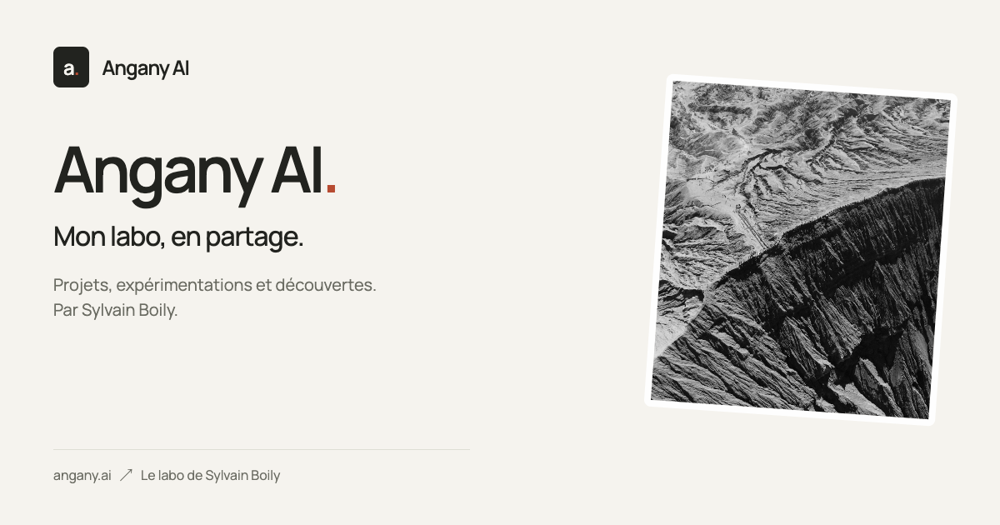

# Angany AI

**Sylvain Boily's personal lab, shared in the open.** Projects, experiments and lessons learned
in voice, AI and open source, written like a field notebook.

[**angany.ai**](https://angany.ai/) · [English](https://angany.ai/en/) · [Français](https://angany.ai/)



## What's inside

One page, five chapters, in French at the root and English under `/en/`:

| | Chapter | What it covers |
|---|---|---|
| 01 | **Right now** | What I'm building today: Luge, an AI colleague on the team, and RoomKit, one conversation across every channel |
| 02 | **Out in the open** | Open source projects and contributions, filterable by topic: sealwax, BuzzKit, aiortp, aiosipua, CallKeep… |
| 03 | **The journey so far** | From a DOS PC with no hard drive, around 1988, to XiVO, Wazo and Tchat N Sign |
| 04 | **Notes & conversations** | Interviews, talks and technical write-ups |
| 05 | **Off the beaten path** | Side projects that started with "what if we tried?", like a card game and Dungeons & Dragons tools, and life away from the keyboard |

## Zero dependencies, on purpose

- **Plain HTML, CSS and JavaScript.** No framework, no bundler, no `npm install`. The build is a
  few Node scripts using only the standard library.
- **Complete HTML, before any script runs.** Projects, links and translations work with
  JavaScript turned off. Scripts only add the mobile menu, the project filters, copying the email
  address and the reveal animations.
- **Nothing tracks you.** No cookies, analytics, local storage, remote fonts or client-side
  framework. Fonts, icons and images are served from the site itself.
- **Checked before every deploy.** `npm run check` compares both languages key by key, then
  checks JavaScript syntax, HTML structure, local links, anchors and assets.

## Run it locally

Node.js 22 or later:

```sh
npm run dev
```

Open http://localhost:4173. The pages rebuild and the browser reloads whenever `src/` or
`assets/` changes. Set `PORT=4174` to use another port.

```sh
npm run build    # writes the static site to dist/
npm run check    # translations, syntax, links, anchors and assets
npm run preview  # serves dist/ as is, without rebuilding
```

## Project layout

| Path | Contents |
|---|---|
| `src/content/fr.js`, `en.js` | Every piece of text, navigation and metadata, one file per language |
| `src/content/shared.js` | What both languages share: contact details, social links, repositories, article links |
| `src/template.js` | The HTML of every section and page, as template strings |
| `assets/styles.css` | Typography, layout and responsive rules |
| `assets/main.js` | Mobile menu, project filters, email copy and reveal animations |
| `assets/images/`, `fonts/`, `logos/`, `icons.svg` | Self-hosted assets, credited in `assets/CREDITS.txt` |
| `scripts/` | Build, development server and checks, in plain Node |

## Adding an open source project

1. Add an entry to `repositories` in `src/content/shared.js`. Public repositories only.
2. Add its description to `openSource.descriptions` in both `fr.js` and `en.js`, at the same
   position: descriptions are matched to repositories by order.
3. For a new topic, add `[id, label]` to `openSource.filters` in both languages, with the same
   `id` as the entry's `category`.
4. Run `npm run check`, then add the repository to the [sources](#sources) below.

The grid shows three cards per row on desktop, two on tablets and one on phones.

## Deployment

`dist/` is a self-contained static site. On every push to `main`,
[`.github/workflows/deploy.yml`](.github/workflows/deploy.yml) builds it, checks it and publishes
it to GitHub Pages. It can also be started from the Actions tab. Pull requests run the checks
without publishing. The workflow relies on GitHub Actions' built-in permissions, so there is no
personal secret to create or renew. The development commands never push or deploy.

To roll back a published change, revert its commit and push to `main`: the same workflow
publishes the site again.

<details>
<summary>GitHub Pages and DNS settings</summary>

- In **Settings → Pages**, the source is **GitHub Actions**, the custom domain is `angany.ai` and
  HTTPS is enforced. The `CNAME` file ships with the output, but the domain itself is attached in
  the Pages settings.
- DNS stays with GitHub Pages: the domain's A records point to `185.199.108.153`,
  `185.199.109.153`, `185.199.110.153` and `185.199.111.153`. `www` is a CNAME to
  `anganyai.github.io` and redirects to `angany.ai`.

</details>

## History

This repository holds only the new lab. The previous Docusaurus site and its history live in the
private repository `anganyAI/angany-website-old`, with its workflows disabled; its old GitHub Pages
address only redirects to https://angany.ai/. The old product and documentation pages were not
carried over, and the 404 page sends visitors back home.

## Content notes

- Personal dates, hobbies, the CTO role and contact details come from Sylvain. The first computer
  stays dated **around 1988**.
- CallKeep is described as a contribution: the site does not credit Sylvain with creating the
  React Native WebRTC module.
- The Luge link opens an email until there is a public page to point to.
- RoomKit articles are credited as posts from the RoomKit blog.
- The portrait is the GitHub profile photo, a placeholder until a personal one replaces
  `assets/images/sylvain.jpg`.

## Sources

Main references, consulted on November 1, 2026 unless noted:

- https://github.com/sboily and https://github.com/anganyAI
- https://www.roomkit.live/ and https://github.com/roomkit-live
- https://luge.tchatnsign.ai/docs/product/what-is-luge.md
- https://wazo-platform.org/blog/introducing-wazo/
- https://www.voiceaispace.com/industry-conversations/founder-interview-sylvain-boily
- https://github.com/sboily/dndkit (from gamemaster-mcp)
- https://github.com/sboily/n8n-nodes-hubitat
- https://github.com/sealwax/sealwax (November 16, 2026)

## Credits

Landscape photograph by Hanson Lu on Unsplash. Manrope and Geist Mono under the SIL Open Font
License; Phosphor and Bootstrap icons under the MIT license. Details and sources for every image,
font, icon and logo: [`assets/CREDITS.txt`](assets/CREDITS.txt).
